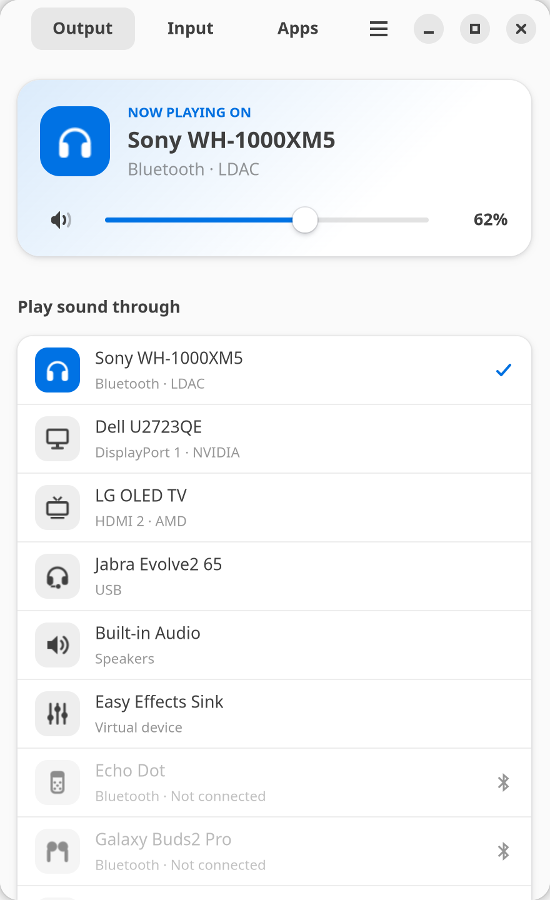
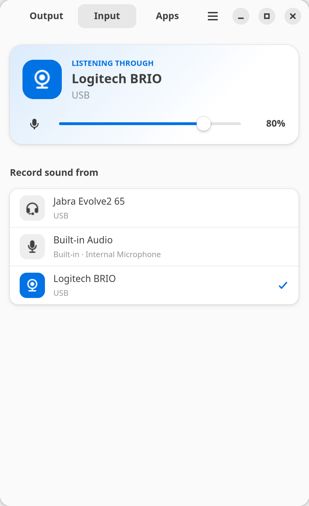
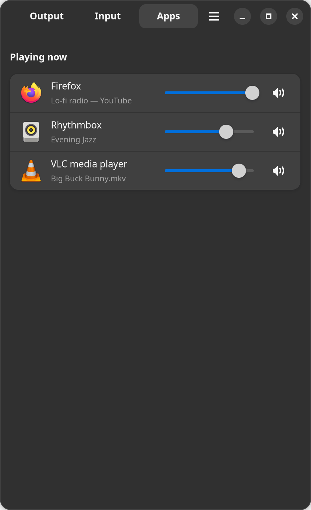
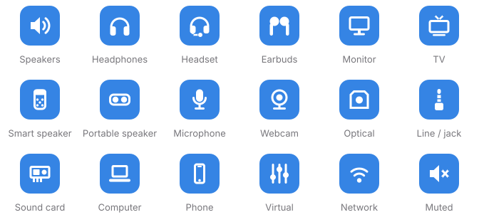

<div align="center">


# Audio Switcher

Switch speakers, monitors, headsets and microphones from the top bar, the
same way GNOME Settings does it, but one click away.

<picture>
  <source media="(prefers-color-scheme: dark)" srcset="docs/screenshots/output-dark.png">
  
</picture>
<picture>
  <source media="(prefers-color-scheme: dark)" srcset="docs/screenshots/input-dark.png">
  
</picture>


</div>

## Features

- **Tray menu.** Every output and input, with an icon for what it is and a
  mark on the current one. Scroll over the icon to change the volume,
  middle-click to mute.
- **Real device names.** HDMI and DisplayPort outputs show the monitor's own
  name, like *Dell U2723QE* or *LG OLED TV*, instead of *HDMI 2*.
- **Switches like GNOME Settings.** Picking a port changes the card profile
  first, so every connector is selectable, not just the one that's active.
- **Bluetooth.** Paired speakers and headphones are listed even when they're
  disconnected; one click connects them and switches to them. Speakers that
  connect "backwards" (as an audio source, like an Amazon Echo) are flipped
  automatically.
- **Remembered configurations.** Pick a codec or profile once (say SBC-XQ or
  LDAC), and it is restored every time that device reconnects.
- **Updates itself.** It checks for new releases and shows an *Update*
  button, which upgrades through mise or the .deb, whichever you used.
- **Per-app volume** and **card configuration**, in a small libadwaita
  window that follows the system light/dark style.

<p align="center"></p>

## Install

Linux with PipeWire (or PulseAudio), GTK 4 and libadwaita 1.7 or newer.
That's Ubuntu 25.04+, Fedora 42+, Arch and similar. On GNOME, the tray needs
the [AppIndicator extension](https://extensions.gnome.org/extension/615/appindicator-support/)
(enabled by default on Ubuntu).

**With [mise](https://mise.jdx.dev)**, using this repository's `<owner>/<repo>`:

```sh
mise use -g 'github:<owner>/<repo>[matching=.tar.gz]'
audio-switcher --install   # launcher, icons and tray at login, for your user
```

If your mise config sets `minimum_release_age`, new releases appear after
that delay.

**As a .deb (all users):** download it from the [latest release](../../releases/latest),
then:

```sh
sudo apt install ./pckz-audio-switcher_*_amd64.deb
```

**From source:** `make build`, then `./bin/audio-switcher --install`.

## Usage

```
audio-switcher              open the window (and start the tray)
audio-switcher --tray       tray only, which is what runs at login
audio-switcher --list       print devices and exit
audio-switcher --install    set up launcher, icons and autostart for this user
audio-switcher --uninstall  remove them
audio-switcher --update     upgrade to the latest release (--check-update to just look)
```

## Development

Pure Go with no cgo: GTK 4 and libadwaita are loaded at runtime through
[puregotk](https://codeberg.org/puregotk/puregotk), so building needs only
Go.

```sh
make run     # build and run
make demo    # run against made-up devices; real audio is not touched
make test lint
make dist    # release tarballs and .debs for amd64 and arm64
```

Releases are cut automatically from [Conventional Commits](https://www.conventionalcommits.org)
on `main`. See [AGENTS.md](AGENTS.md) for how the code is organised.

## License

[MIT](LICENSE)
